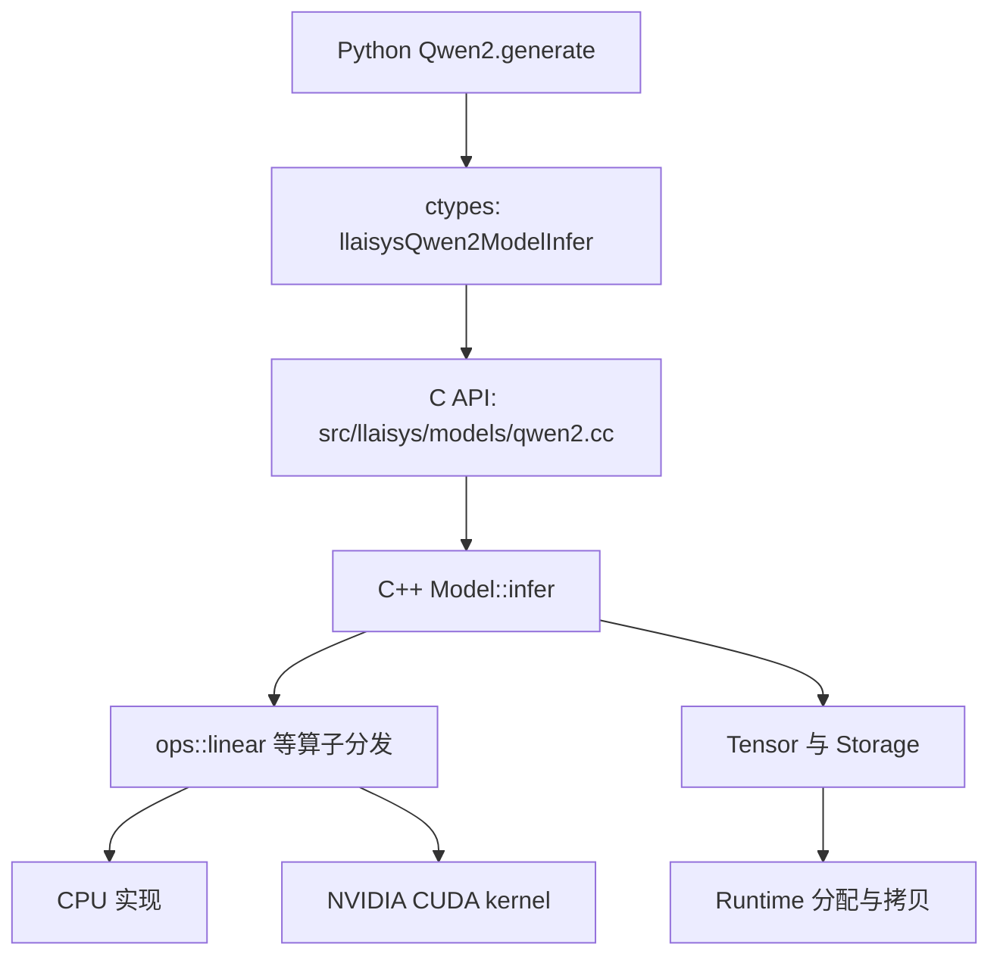

# LLAISYS 学习与求职方案：从读懂一次推理，到做出可复现的优化

文档更新：2026-11-03；实验与测量仍引用 2026-11-02 的记录，本次未重跑实验。按此前反馈，你已经理解 Qwen2 `infer`、attention/GQA/RoPE/KV Cache 和权重加载；作业 1/2 的 Tensor 核心方法与七个 CPU 算子由你独立完成。当前重点是亲自复现、修改和讲解作业 3/4 的实现，并继续定位生成分歧。

**本轮实际实现、数据与后续验收以[优化实验总表](docs/optimization/README.md)为准。** [KV Cache讲解](docs/optimization/KV_CACHE_AND_FORWARD.md)回答前向与缓存管理，[简历与面试主文档](docs/optimization/RESUME_AND_INTERVIEW.md)统一维护三条描述、32 个问答及指标解释；[一个月计划](RESUME_AND_30_DAY_PLAN.md)同步简历文案并保留求职安排及贡献来源。本文主要作为数学、代码地图与个人练习方法查阅，不另维护一套投递模板。

这份方案的目标是：你能够从一个 token 的编号出发，讲清楚它经过哪些计算、数据放在哪里、为什么结果正确、哪里慢，以及你怎样通过实验让它变快。项目大不大、功能多不多，是次要的。

**当前范围：单卡NVIDIA、单请求、batch=1；CPU保留参考。** 本轮已按你的授权完成八个CUDA算子优化、工作区/Cache执行优化、直接阶段计时和profiling，不实施其他GPU平台。接下来以自己复现和讲解为主，不要求从头再写一套系统。

**最新验证（2026-11-02）：** 140个算子实验组合、57项CUDA边界、小模型GPU/CPU各36项回归、原有8个GPU算子脚本和Runtime检查通过。小模型对照主要检查预测 ID、缓存状态与接口行为，不代表 logits 逐元素一致。真实模型9条WikiText首token全一致；最多8个输出时仅5/9序列完全一致，仍有后续生成分歧，不能宣布HF完整生成对齐。已有第一层到最终logits诊断、整机/算子数据与真实Nsight证据，见[总表](docs/optimization/README.md)。

**历史对照（2026-11-01）：** 当时0/9序列一致，第一层input Norm已有偏差，记录保留在[旧生成报告](docs/results/token_compare_20261101.md)和[旧张量报告](docs/results/tensor_compare_20261101.md)。不能把旧状态当今天的实现，也不能把数值设置不同的结果直接当同配置A/B。

## 阅读导航

- 今天就开始：[第 1 节](#1-今天先做什么)；不要一次读完整篇。
- 不明白作业 3、4 在干什么：[第 2 节](#2-把作业-3-4-翻译成具体工作)。
- 想知道代码在哪里、实际完成了多少：[第 3 节](#3-当前仓库的真实地图与问题)。
- 数学公式不会落地：[第 4 节](#4-前置知识只补当前用得上的部分)和[第 5 节](#5-从公式走到代码用小数字理解一层模型)。
- 近期按块练习与求职安排：[一个月计划](RESUME_AND_30_DAY_PLAN.md)；从头学习的历史路线保留在[第 6 节](#6-学习安排每一步都要留下可检查的产物)。
- 找简单开源项目：[第 7 节](#7-开源项目按这个顺序学)。
- 测试、benchmark、profiling 怎么改：[第 8 节](#8-测试与性能分析保留框架分阶段补齐)。
- 简历做到什么程度：[第 9 节](#9-做到什么程度适合写简历)。
- 早期删了什么、验证了什么：[第 10 节](#10-早期清理与验证记录历史快照)。

## 1. 今天先做什么

infer 和权重加载已理解。本轮代码与测量已由 AI 辅助落地，接下来按“短答 → 手算或画图 → 代码定位 → 复现实验 → 解释限制”做个人验收，不能仅把问答读顺就算掌握：

1. 先读Cache讲解并用`model.state`观察prefill/decode/reset，手算容量与有效长度。
2. 独立跑Argmax V0/V2，解释两阶段归约；复现一次P64/N8回放，读懂TTFT/TPOT/分配统计。
3. 沿着 Linear/Attention 记录解释“原来浪费在哪里、怎样改、测试证明什么”；用阶段数据区分算子与执行策略的共同收益，结合 Nsight 区分访存和同步等待。约 90% DRAM 吞吐只来自所测的一个 GEMV 尺寸。
4. 对4条HF后续生成分歧继续做同输入teacher-forced定位；当前已有第一层和最终logits导出，decode逐步根因尚未闭环。简历先采用阶段性事实与自家基线回放指标，不写完全对齐或HF等质量加速。

框架底层读到能解释所有权、view/slice、分配释放、复制和同步即可；遇到具体瓶颈或资源问题再深入。作业 3/4 的实现与实验是近期投入中心。

### 1.1 当前机器可使用的命令

从仓库根目录运行。这里使用已有 `.venv`；换机器时先按 README 安装编译工具与 Python 依赖。`PYTHONPATH=python` 可以确保导入正在编辑的源码，但 `.so` 仍需要重新编译安装。

```bash
# 只有切换构建配置时才需要重新配置
xmake f -c --nv-gpu=y -m release
xmake -y
xmake install -y

PYTHONPATH=python .venv/bin/python test/test_runtime.py --device nvidia --extended
PYTHONPATH=python .venv/bin/python test/ops/linear.py --device nvidia
PYTHONPATH=python .venv/bin/python test/test_qwen2_api.py

# 当前已有本地模型；先只生成 3 个 token
PYTHONPATH=python .venv/bin/python test/test_infer.py \
  --model ./DeepSeek-R1-Distill-Qwen-1.5B \
  --device nvidia --test --max_steps 3
```

注意：`test_qwen2_api.py` 默认只检查 CPU 模型创建、权重形状、reset 和销毁，**没有检查真实前向数值**。`test/test_infer.py` 的 `--test` 会选择 argmax 对照；普通模式的默认 `top_k=50` 与当前后端只支持 `top_k=1` 不兼容。

原 README 写到的 `test/test_ops.py` 在当前仓库不存在。请逐个运行 `test/ops/*.py`，或使用已有的 `benchmark/benchmark_ops.py`（后者会同时计时）。

## 2. 把作业 3、4 翻译成具体工作

### 2.1 作业 3：把已有的零件连接成能生成文字的机器

你之前的工作证明了“某个算子收到输入，可以算出正确输出”。作业 3 要求把这些算子按模型规定的顺序接起来，再装入训练好的参数。

| 原要求 | 大白话解释 | 本仓库对应位置 |
| --- | --- | --- |
| 读取模型配置 | 先知道模型有多少层、每层多宽、多少个注意力头 | Python `Qwen2.__init__` |
| 加载 safetensors | 把别人训练好的数字搬进你分配的 Tensor，名字和形状都要对应 | `_load_weights`、`_assign_backend_weight` |
| C/C++ 实现模型 | 按规定顺序调用算子；不能用 `transformers.generate()` 替你计算 | C++ `Model::infer` |
| 提供 C API | 给 Python 留下可调用的入口，类似“创建、取权重、重置、计算、销毁”五个按钮 | `include/llaisys/models/qwen2.h` |
| ctypes | 把 Python 参数按 C 函数需要的指针、整数、结构体格式传过去 | `python/llaisys/libllaisys/qwen2.py` |
| KV Cache | 保存历史 token 在每层的 K、V，生成下一个 token 时复用 | `allocateCache`、`_cached_len` |
| 与 PyTorch 对齐 | 同一组 token、权重和生成规则，比较输出 token；定位错误时还要比较中间数值 | `test/test_infer.py --test` |

Python 这里可以用 PyTorch 读取 safetensors 的 CPU Tensor，再把其内存复制给后端。这与“用 PyTorch 执行模型前向”是两件事；现有有效路径的前向在 C++/CUDA 中。

不用训练模型，不用自己实现 tokenizer，也不用先学梯度下降。先把已有模型的前向计算学明白。

### 2.2 作业 4：让整台机器用上 GPU

“写了 GPU 算子”只是其中一部分。还需要保证权重在 GPU、临时数据在 GPU、分配和拷贝用 CUDA API、算子分发走到 GPU 实现。

- **Runtime**：设备操作接口。申请 GPU 内存调用 `cudaMalloc`，搬数据调用 `cudaMemcpy`，等待 GPU 完成调用同步接口。
- **Device backend（设备后端）**：为某个平台提供 Runtime 和算子实现。
- **Context**：记录当前线程正在使用哪个设备及其 Runtime。
- **Stream（流）**：GPU 工作队列。同一流中的工作按顺序执行；CPU 发起调用后，GPU 可能还没完成。
- **构建系统**：让 `.cu` 文件经过 CUDA 编译器编译，并把实现链接到 Python 加载的动态库里。

原 README 保留了课程要求的两个 GPU 平台，但本项目按你的资源和求职目标缩小范围：**仅实现、验证和优化 NVIDIA CUDA 后端，不开展第二平台适配。** CPU 后端继续用于数学参考和回归测试。

下文作业 4 的学习与验收都围绕 CUDA Runtime、GPU 算子和单卡模型推理展开；没有第二平台不会阻塞你的项目进度。对外描述为“完成 NVIDIA CUDA 后端”，准确说明支持范围即可。

## 3. 当前仓库的真实地图与问题

### 3.1 只跟一条调用链读代码



先走 `generate → Infer → Model::infer → ops::linear → nvidia::linear → linear_blas/cuBLAS`；`linear_k` 是保留的基础版本。走通之后再读其他算子，避免从头到尾按目录硬读。

| 文件/目录 | 负责什么 | 第一遍读到什么程度 |
| --- | --- | --- |
| [python/llaisys/models/qwen2.py](python/llaisys/models/qwen2.py) | 配置、权重装载、生成循环 | 能解释五个主要方法：初始化、加载、权重映射、生成、析构 |
| [python/llaisys/libllaisys/qwen2.py](python/llaisys/libllaisys/qwen2.py) | ctypes 结构体与函数签名 | 找到 `argtypes/restype`，和 C 头文件逐项对应 |
| [include/llaisys/models/qwen2.h](include/llaisys/models/qwen2.h) | 对外模型接口 | 分清 Meta 是配置，Weights 是 Tensor 句柄，Model 是后端对象 |
| [src/llaisys/models/qwen2.cc](src/llaisys/models/qwen2.cc) | 从 C 接口进入 C++ | 看懂包装关系，暂不扩展接口 |
| [src/models/qwen2/model.cpp](src/models/qwen2/model.cpp) | 权重、缓存和完整模型前向 | 本次学习的中心文件 |
| [src/ops/linear/op.cpp](src/ops/linear/op.cpp) | 检查 shape/dtype/device，选择实现 | 理解“算什么”和“在哪里算”分开 |
| [src/ops/linear/nvidia/linear_nvidia.cu](src/ops/linear/nvidia/linear_nvidia.cu) 等各算子 `nvidia/` 子目录 | 当前实际使用的八个 CUDA 算子 | 七个作业算子加 add；与各自 `cpu/` 目录并列 |
| [src/ops/nvidia/common.cuh](src/ops/nvidia/common.cuh) | CUDA 共用的类型读写和 launch 错误检查 | 不放具体算子算法，修改时回归全部 CUDA 算子 |
| [src/ops](src/ops) 下各 `cpu/` | 直接表达数学含义的 CPU 实现 | 卡在 CUDA 索引时先看 CPU 循环 |
| [src/tensor/tensor.cpp](src/tensor/tensor.cpp) | shape、stride、view、slice、存储 | 用一个小数组算地址，不必先背全部代码 |
| [src/core](src/core) | Context、Runtime、Storage、Allocator | 学缓存与内存优化时再深入 |
| [src/device/nvidia/nvidia_runtime_api.cu](src/device/nvidia/nvidia_runtime_api.cu) | CUDA 内存、流、同步 | 对照 CPU 版本，追一次 H2D/D2H |
| [xmake.lua](xmake.lua)、[xmake](xmake) | 编译、链接、安装动态库 | 知道修改源码后如何生成被 Python 使用的库 |
| [test](test)、[benchmark](benchmark)、[profile](profile) | 正确性检查、速度统计、性能诊断 | 三种目的分清楚 |

`src/llaisys/` 和 `python/llaisys/libllaisys/` 看上去重复，是语言接口层，不能删。`src/ops/rearrange/` 是数据重排接口，即使当前模型主路径少用，也不能当垃圾删除。

### 3.2 已实现，不代表已经充分验证

源码中可以确认：有 C++ Qwen2 前向、causal GQA、RoPE、KV Cache、CPU/NVIDIA 分发、八个 CUDA 算子、权重加载、argmax 生成、算子设备微基准、同一请求的 prefill/decode 直接计时与报告脚本。

当前范围和限制：

- 单请求、单设备；不是连续批处理服务，也没有多 GPU 推理。
- Python 模型加载器固定要求 BF16；C++ Meta 接受 F32/F16/BF16，不等于 Python 能加载这三种模型权重。
- KV Cache按运行容量预分配；E2复用中间工作区，热身后相同规模前向不再申请设备Tensor存储。
- CUDA保留基础和优化分支，Linear已接cuBLAS；Attention复用中间结果，但不是FlashAttention。
- 非连续 GPU Tensor 的 `contiguous()` 尚未支持。模型当前的主要 view/slice 不等于通用 GPU Tensor 能力。
- 常规infer仍只返回ID；可选debug导出覆盖第0层主要阶段与最终logits，计时时必须关闭。
- 模型benchmark已有prefill/decode NVTX与热身后采样开关；没有逐层NVTX。
- CI 主要是 CPU 构建/测试；不能用绿色 CI 证明 NVIDIA 后端通过。现有模型 CI 还依赖在线下载真实权重。

### 3.3 代码审阅发现的具体问题

下面是2026-11-01审阅快照，保留问题缘由；**0/负输出长度、模型C API异常边界、token/head_dim检查、Context引用、Cache容量、直接阶段计时、八算子和末位置投影等已在后续修正。** 当前仍未支持任意非连续GPU Tensor，也未完成所有HF生成分歧归因。最新状态以优化总表为准。

| 优先级 | 发现 | 对你的影响与下一步 |
| --- | --- | --- |
| P0：正确性 | `generate(max_new_tokens=0)` 仍会调用一次 infer 并追加 token；负数也未明确拒绝 | 先规定接口语义，0 返回原输入，负数报错，再补小测试 |
| P0：接口边界 | C++ `CHECK_ARGUMENT` 抛异常，模型 C API 没有捕获和错误返回协议 | 非法输入可能终止 Python 进程，不能假设 `try/except` 能捕获；先设计状态码/错误消息，再加非法输入测试 |
| P0：参数检查 | token ID 范围、RoPE 偶数 head_dim 等条件没有在模型入口完整检查 | 必须明确合法输入，避免非法 embedding 访问；检查应放在 CUDA launch 前 |
| P1：资源 | `Context::setDevice` 的 `auto runtimes = _runtime_map[device_type]` 复制了 vector | 新建 Runtime 没写回 map，切换设备可能重复创建并泄漏；需要引用语义和生命周期回归 |
| P1：内存 | Cache 容量直接使用 `max_position_embeddings=131072` | 该配置 KV Cache 为3.5 GiB（更正旧文算术错误）；把模型支持上限和本次运行容量分开 |
| 已修正：测试 | attention 参考实现的 mask 在 CPU 创建，数据在 query 设备 | 本次复跑确认报错；已加 `device=query.device`，GPU 用例通过 |
| P1：测量 | 模型 TPOT 用两次独立 generate 的耗时相减估计，还用 `max(0, ...)` 截断 | 抖动可能掩盖错误；改成同一次生成中直接记录 prefill/decode |
| P1：测量 | CUDA Event 在 PyTorch 当前流记录，LLAISYS kernel 默认流 launch | 当前默认流场景可能可用，但不能保证任意流下正确；显式统一流或建立依赖 |
| P2：性能 | Linear 每个输出元素一个线程，线程内遍历 K；RMSNorm 每行一个线程 | 具备明显优化空间，但具体耗时占比仍要用 profiler 测 |
| P2：性能 | attention 对每个输出通道重复计算 Q·K，且为稳定 softmax 计算两轮 | 先理解共享 score/reduction，再考虑分块或成熟实现 |
| P2：性能 | 每层重复生成相同 position IDs；prefill 为所有位置算 LM head 后只取最后一行 | 可以作为小范围、可解释的优化实验 |
| P2：构建 | `xmake/nvidia.lua` 声明的静态 target 与共享 target 都列出设备源码，构建关系值得整理 | 当前能构建不等于结构清楚；查依赖图、干净构建后再改，不直接删除平台构建文件 |

`P0/P1/P2` 表示建议先后，不表示所有问题都会在当前合法输入下触发。测试通过也不会自动排除接口边界和资源生命周期问题。

### 3.4 框架提供与个人作业的边界（2026-10-30 核查）

以作业 1 首次提交 `74217f6` 的父提交 `7740d46` 为本地课程基线。`src/core/`、CPU Runtime、CPU add 示例、通用接口和测试主体来自框架。Tensor 核心视图/加载方法和七个 CPU 算子在作业 1/2 提交中补齐；Qwen2 原型与占位 Python 类已有，但完整 C++ 前向、KV Cache、权重映射、模型 ctypes 绑定及 CUDA Runtime/kernel 是后续工作。

其中 `94b078c`、`f23b543` 新增的是 CPU 算子，CUDA kernel 出现在 `63d5f78`，与作业 3/4 的 AI 辅助经历对应。因此，之前把“独立完成七个算子”直接写为“独立完成七个 CUDA 算子”的描述不准确，此处已纠正。Git 能证明增改历史，手写/AI 来源需结合你的真实经历；不能从提交 author 自动推定。

详细文件、提交证据、模型头文件已有与新增部分，以及框架所需理解深度，见 [短期计划第 0 节](RESUME_AND_30_DAY_PLAN.md)。AI 辅助实现可以作为你负责的项目工作，但应能解释、验证和修改；不把“看懂”自动写成“独立手写/设计”或已完成实验。

## 4. 前置知识：只补当前用得上的部分

你有 SGEMM 基础，不需要重新从 CUDA 入门学起。当前缺口主要是“模型数学 → shape → 内存布局 → 调用链”。

| 知识 | 需要掌握到哪里 | 一个自测任务 |
| --- | --- | --- |
| 向量、矩阵、求和符号 | 点积是对应元素相乘再求和；矩阵乘法是一组点积 | 把 `Y=XWᵀ` 写成三层 for 循环 |
| 指数、平方根、softmax | 知道归一化与减最大值的作用 | 手算两个数的 softmax，验证加同一常数结果不变 |
| Tensor 内存 | shape 是维度大小，stride 是跨一格跳几个元素，offset 是字节偏移 | `[2,3]` 连续矩阵的 stride `[3,1]`；转置后 `[1,3]` |
| C++ 对象与内存 | 引用、指针、vector、RAII、shared_ptr/unique_ptr | 解释一个 slice 为什么不会在原 Tensor 析构后立即失效 |
| Python/C 边界 | `ctypes.Structure` 字段顺序/类型，指针生命周期，argtypes/restype | 对照 Meta 的每个 C 字段，不把 `size_t` 当普通 32 位 int |
| FP32/FP16/BF16 | 低精度存储和 FP32 累加是两回事；不同计算顺序会舍入 | 同一小 GEMM 用 FP32、BF16 输入，记录误差而不是只看 pass |
| CUDA 执行 | 异步 launch、流、同步、Event | 解释 CPU 函数返回为何不代表 GPU 完成 |
| 自回归生成 | token、logits、argmax、EOS、prefill、decode | 画出输入 3 个 token、输出 3 个 token 时每次 infer 的输入和 cache 长度 |

暂时不用补：反向传播推导、优化器、分布式训练、复杂 tokenizer 算法、MoE、量化训练。它们不会帮助你最快读懂当前 `Model::infer()`。

## 5. 从公式走到代码：用小数字理解一层模型

### 5.1 统一符号，先写 shape 再写代码

为了手算，先用一个玩具配置：`T=3, H=8, Nq=2, Nkv=1, D=4, I=16, V=32, L=1`。

| 符号 | 含义 | 本项目配置字段 |
| --- | --- | --- |
| T | 本次输入 token 数，prefill 通常大于 1，decode 通常为 1 | `ntoken` |
| S | 本层缓存中包含本次输入的总 token 数 | `old_len + ntoken` |
| H | hidden size，每个 token 的隐藏向量长度 | `hs` |
| Nq / Nkv | query 头数 / key-value 头数 | `nh` / `nkvh` |
| D | 每个 head 的维度，当前模型 `H=Nq×D` | `dh` |
| I | MLP 扩展维度 | `di` |
| V | 词表大小，这个 V 是维度符号，不是 attention 的 Value 张量 | `voc` |
| L | Transformer 层数 | `nlayer` |

本地真实配置为 `H=1536, Nq=12, Nkv=2, D=128, I=8960, V=151936, L=28`。这些数字来自本地 `config.json`，不是所有 Qwen2 模型的通用常数。

### 5.2 Embedding：编号查表

token ID 只是词表编号，没有“编号越大含义越强”的意思。Embedding 权重是 `[V,H]` 的表。输入 `[2,0]` 就把第 2 行和第 0 行复制出来，得到 `[2,H]`。

```python
# 学习用 PyTorch 参考；不放进后端实际前向
hidden = embedding_weight[token_ids]   # [T, H]
```

对应 CPU 循环：`out[t,h] = weight[ids[t],h]`。CUDA 里将 `i=t*H+h` 展平。先问自己：`ids` 为什么是 int64，而权重为什么是 BF16？

### 5.3 Linear：你熟悉的 GEMM 加上模型含义

输入 `X[T,H]`，权重 `W[N,H]`，输出 `Y[T,N]`：

\[
Y_{t,n}=\sum_{h=0}^{H-1}X_{t,h}W_{n,h}+b_n
\]

`W` 在文件里是 `[输出维度, 输入维度]`，所以公式写 `XWᵀ`，并不要求先真的复制出一份转置矩阵。

```python
for t in range(T):
    for n in range(N):
        acc = 0.0 if bias is None else bias[n]
        for h in range(H):
            acc += X[t, h] * W[n, h]
        Y[t, n] = acc
```

例子：`X=[1,2]`，`W=[[3,4],[5,6]]`，无 bias，输出 `[11,17]`。

Q/K/V projection 是三次不同权重的 Linear。它们不是把输入向量简单切三份；每次都对整个 hidden 向量做线性变换。学到这里就可以把你的 SGEMM 经验接进来了。

### 5.4 RMSNorm：按一行的整体大小缩放

\[
m=\frac{1}{H}\sum_h x_h^2,\qquad y_h=x_h\frac{1}{\sqrt{m+\epsilon}}w_h
\]

`x=[3,4]`、`w=[1,1]`，忽略很小的 epsilon：平方均值是 `12.5`，输出约 `[0.8485,1.1314]`。它没有像 LayerNorm 那样减均值。

```python
variance = (x.float() ** 2).mean(dim=-1, keepdim=True)
y = x.float() * torch.rsqrt(variance + eps) * weight.float()
```

上面用 FP32 表达数学参考，真实后端还要考虑回写 BF16 的时机。基础 V1 一行由一个线程完成；当前 V2 让一个 block 协作，每个线程累加部分平方和，先做 warp 内归约，再经共享内存合并各 warp 的部分和。要解释的是如何把同一行分给线程，以及归约后的结果怎样供整行输出使用，详见 [RMSNorm 记录](docs/optimization/rms_norm.md)。

### 5.5 Q/K/V 与 GQA：多个 query 头共用一组历史 K/V

投影和 view 后：

```text
Q: [T,H]       → [T,Nq,D]
K: [T,Nkv×D]   → [T,Nkv,D]
V: [T,Nkv×D]   → [T,Nkv,D]
```

Q 表示当前位置用什么特征去查询，K 用来匹配，Value 用来加权汇总。这是帮助理解的说法，具体含义由训练出来的权重决定。

GQA（Grouped-Query Attention，分组查询注意力）中，`group_size=Nq/Nkv`，`kv_head=q_head//group_size`。真实配置是 12 个 Q 头共用 2 个 KV 头，前 6 个 Q 头用 KV 头 0，后 6 个用 KV 头 1。

可以在参考实现中 `repeat_interleave` 复制 K/V 头来验证，但实际 kernel 用索引映射就行，不必真的复制六份。

### 5.6 RoPE：用位置决定旋转角度

Q、K 的内容本身不足以说明 token 的先后顺序。RoPE（Rotary Position Embedding，旋转位置编码）按绝对位置旋转它们。当前实现对每个 head 向量分成前后两半配对：`(x[j], x[j+D/2])`，不要写成相邻元素配对后还直接加载同一套权重。

对第 j 对、位置 p：

\[
\phi_{p,j}=p/\theta^{2j/D},\quad
\begin{bmatrix}a'\\b'\end{bmatrix}
=\begin{bmatrix}\cos\phi&-\sin\phi\\\sin\phi&\cos\phi\end{bmatrix}
\begin{bmatrix}a\\b\end{bmatrix}
\]

令 `D=4`，向量 `[a0,a1,b0,b1]`，两对就是 `(a0,b0)`、`(a1,b1)`。位置 0 时角度为 0，输出应与输入相同，这就是一个很便宜的正确性测试。

为什么这能表达相对位置？旋转矩阵满足 `R(p)ᵀR(s)=R(s-p)`，因此旋转后的 Q、K 点积与位置差有关。先理解这条性质即可，不需要从头证明整篇论文。

```python
half = D // 2
freq = theta ** (-2 * torch.arange(half, dtype=torch.float32) / D)
angle = positions[:, None, None] * freq[None, None, :]
a, b = x[..., :half].float(), x[..., half:].float()
y = torch.cat((a * angle.cos() - b * angle.sin(),
               b * angle.cos() + a * angle.sin()), dim=-1)
```

`positions` 必须是全局位置：缓存已有 3 个 token 时，新 token 的位置是 3，不能再次从 0 开始。缓存保存的是旋转之后的 K，以及未做 RoPE 的 V。

### 5.7 Attention：先打分，再归一化，再加权求和

针对一个 query 头，省略头索引：

\[
z_{t,s}=\frac{\sum_{d=0}^{D-1}q_{t,d}k_{s,d}}{\sqrt D}
\]

假设点积里各项大致独立、量级相近，累加 D 项会使方差随 D 增大；除以 `sqrt(D)` 有助于控制分数量级。这是缩放的直觉，不是任何数据分布下的严格保证。

causal mask（因果掩码）禁止当前位置看到未来。当前 chunk 的第 t 个 query 的全局位置是 `old_len+t`，只能看 `s<=old_len+t`。

稳定 softmax：

\[
m_t=\max_{s\text{ 可见}}z_{t,s},\quad
p_{t,s}=\frac{e^{z_{t,s}-m_t}}{\sum_{u\text{ 可见}}e^{z_{t,u}-m_t}},\quad
out_{t,d}=\sum_{s\text{ 可见}}p_{t,s}v_{s,d}
\]

减去最大值不改变比例，却避免直接对大正数取指数导致溢出。被遮住的位置用负无穷，指数为 0。

手算：分数 `[0,ln(3)]` 的 softmax 为 `[1/4,3/4]`。若两个 Value 分别是 `[2,0]` 与 `[0,4]`，输出就是 `[0.5,3]`。

decode 的 `T=1,S=4` 时，唯一 query 可看全部 4 个位置。若错误地套一个从左上角开始的普通下三角 mask，就只剩第一个位置可见。仓库 kernel 的 `limit=KL-Q+qp+1` 正是在处理这个偏移。

基础实现为每个输出通道重复计算同一份 QK 打分与 softmax；当前 V2 拆成 QK、softmax、PV 三步，并复用分数存储。收益来自消除重复工作和并行归约，代价是保留 `QL×HQ×KL` 大小的中间分数；它不是 FlashAttention 的分块融合算法。实现与实测见 [Attention 记录](docs/optimization/self_attention.md)。

### 5.8 可以直接运行的小实验：验证 GQA 和 cache 切片

以下只依赖 PyTorch，在 CPU 上运行，不需要模型文件。它固定 Q/K/V，验证“完整 causal attention”和“prefill 后读取历史 K/V”的结果一致；**它不验证权重加载、RoPE 或完整 Transformer**。

```python
import torch

torch.manual_seed(0)
T, Nq, Nkv, D = 4, 2, 1, 4
q = torch.randn(T, Nq, D)
k = torch.randn(T, Nkv, D)
v = torch.randn(T, Nkv, D)

def attention(q, k, v, past):
    tq, hq, d = q.shape
    total, hk, _ = k.shape
    assert total == past + tq and hq % hk == 0
    head_map = torch.arange(hq) // (hq // hk)
    qq = q.permute(1, 0, 2)                 # [Nq,Tq,D]
    kk = k[:, head_map, :].permute(1, 0, 2) # [Nq,S,D]
    vv = v[:, head_map, :].permute(1, 0, 2)
    scores = qq @ kk.transpose(-1, -2) / d ** 0.5
    query_pos = past + torch.arange(tq)
    key_pos = torch.arange(total)
    mask = key_pos[None, :] > query_pos[:, None]
    scores = scores.masked_fill(mask[None, :, :], float('-inf'))
    prob = scores.softmax(dim=-1)
    return (prob @ vv).permute(1, 0, 2)

full = attention(q, k, v, past=0)
prefill = attention(q[:3], k[:3], v[:3], past=0)
decode = attention(q[3:], k, v, past=3)
torch.testing.assert_close(prefill, full[:3])
torch.testing.assert_close(decode, full[3:])
print('完整计算与缓存计算一致')
```

练习：把 mask 的 `past` 故意去掉，观察 decode 对照失败；再把 `Nq` 改成 4、`Nkv` 改成 2。能预测哪些 shape 变化，比只运行成功更重要。

### 5.9 SwiGLU、残差与完整的一层

SwiGLU 是一个逐元素门控函数：

\[
\mathrm{SiLU}(g)=g/(1+e^{-g}),\qquad out=\mathrm{SiLU}(gate)\odot up
\]

`gate=0` 时输出为 0；`gate` 为较大的正数时，SiLU 接近 gate。gate 和 up 都是同一输入经过不同 Linear 后得到的 `[T,I]` 张量。

残差连接是 `原输入 + 子模块输出`，使子模块可以在已有表示上做修改。两边 shape 必须相同。

一层实际顺序如下；这里 `linear` 表示带适当权重/bias 的参考函数，代码用于读流程：

```python
u = rms_norm(hidden, attention_norm_weight)    # [T,H]
q, k, v = q_proj(u), k_proj(u), v_proj(u)     # view 成各自的 head shape
q, k = rope(q, positions), rope(k, positions)
# 把 k、v 写进当前层 cache[old_len:old_len+T]
a = attention(q, all_cached_k, all_cached_v) # [T,Nq,D]
post_attn = hidden + o_proj(a.reshape(T, H))  # [T,H]
u = rms_norm(post_attn, mlp_norm_weight)
gate, up = gate_proj(u), up_proj(u)           # [T,I]
hidden = post_attn + down_proj(silu(gate) * up)
```

一层学懂后，28 层就是使用不同权重重复这个结构；不能把第 0 层的 K/V 给第 1 层用。

### 5.10 Logits、argmax 和生成循环

概念上，最后做 RMSNorm，再用 LM head 把每个位置的 hidden 映射到词表分数。当前 E2 执行路径先取最后一个位置，只计算 `[1,H] → [1,V]`；E1 则算 `[T,V]` 后取最后一行。这里只需要最后一个位置预测下一个 token，所以前者减少了 prefill 的冗余词表投影；前面的 Transformer 层仍需处理全部 prompt。logits 是词表中每个候选 token 的分数。

argmax 返回分数最大的 token ID。为做 argmax 不必先算 softmax，因为 softmax 保持大小顺序。EOS 是结束 token，生成它后停止。

```text
输入 prompt=[10,20,30]，缓存起初为空
infer([10,20,30]) → 返回40，缓存长度=3
infer([40])       → 返回50，缓存长度=4
infer([50])       → 返回60，缓存长度=5
返回序列=[10,20,30,40,50,60]
```

最后返回的 60 尚未送入模型，因此不在缓存中。生成 3 个新 token 只需要 1 次 prefill 和 2 次 decode。新请求调用 reset 将有效长度归零，不需要为了正确性把整块缓存清零：只要后续 attention 永远不读取有效范围外的数据。

### 5.11 KV Cache 为什么有用，又为什么占内存

由于 causal mask，历史位置的结果不依赖未来 token，所以每层历史 K/V 可以复用。decode 仍然要读取历史 K/V 做 attention，不能说“有 cache 后每个 token 的计算量与上下文长度无关”。

单请求、各层配置相同且 K/V head_dim 相同的缓存大小：

\[
\mathrm{bytes}=2\times L\times C\times Nkv\times D\times b
\]

2 代表 K 和 V，C 是实际分配容量，b 是每个元素字节数。当前默认 `L=28,C=2048,Nkv=2,D=128,b=2`，结果是 `58,720,256 bytes = 56 MiB`。若按模型位置上限取 `C=131072`，则是 `3,758,096,384 bytes = 3.5 GiB`。**旧版这里多算了一倍，已按公式和 model.state 实测更正。**这还不包括权重、临时 Tensor、CUDA 上下文等；容量改变也不等于同样上下文长度下压缩 KV。

此项已经实现：为用户提供独立 `cache_capacity`，不超过模型位置上限；创建后端时按该容量分配，并让生成长度检查使用它。不要直接改原模型 config 冒充新的模型上限，也不必为了省这块内存立即引入 PagedAttention。

## 6. 学习安排：每一步都要留下可检查的产物

以下是最初面向从头学习的历史参考路线，**不再作为你当前的逐周任务**。你已完成模型前向与权重加载理解，后续诊断导出、直接计时、优化和 profiling 也已落地；以下六周中“待增加”“当前朴素实现”等表述均指早期阶段。近期按 [一个月计划](RESUME_AND_30_DAY_PLAN.md) 做个人复现与面试练习，并行推进真实模型同前缀数值归因，不从头重复开发。

### 第 1 周：把数学和 shape 接起来

| 次序 | 做什么 | 当天交付物 |
| --- | --- | --- |
| 第 1 天 | 按第 1 节追一次生成调用；跑基础测试 | 一张调用链图、一份实际命令与输出记录 |
| 第 2 天 | 手算 embedding、linear、RMSNorm | 三个小例子；每个都有输入、公式、输出和 shape |
| 第 3 天 | 阅读 `llama2.c` 的前向；只看模型计算 | 自己写的运算顺序，不抄整份源码 |
| 第 4 天 | 学 RoPE，验证位置 0 不改变输入 | 一段参考代码和位置 0/3 的结果 |
| 第 5 天 | 运行第 5.8 节实验，改错 mask 再修复 | 解释为什么 decode 不能直接使用普通下三角 mask |
| 第 6 天 | 手写一层 PyTorch FP32 参考：norm、QKV、RoPE、attention、MLP | 每个中间 Tensor 的 shape 和部分数值 |
| 第 7 天 | 合上源码，画完整一层并讲给别人听 | 5 分钟讲解；卡住的三个问题列表 |

这周不追性能。PyTorch 参考实现是你理解和检查后端的工具，不能替换作业要求的 C++ 前向。

### 第 2 周：理解权重、内存和 Python/C++ 边界

只挑一层、一个权重名追踪，例如：

```text
model.layers.0.self_attn.k_proj.weight
→ Python _assign_backend_weight
→ weights.attn_k_w[0]
→ C++ allocateWeights 创建的 [Nkv×D,H]
→ tensorLoad
→ Tensor::load
→ CUDA H2D
→ ops::linear 读取这个 Tensor
```

动手任务：

1. 解释为什么 `source.data_ptr()` 只是地址，后端要在 source 有效时完成复制。
2. 说明 C++ 模型销毁时，权重 Tensor、Cache、Storage 各由谁持有；不要对借用的权重句柄重复释放。
3. 用 `[2,3]` 数组手算 `view/permute/slice` 后的地址变化，检查什么时候需要实际搬数据。
4. 学会区分“改了 `.py` 已生效”与“改了 `.cpp/.cu` 但还在加载旧 `.so`”。

验收：不查源码也能解释某个权重如何从文件变成 GPU 上的一段内存；看到 `[4,8]` 的玩具 K 权重，知道 4 从哪里来。

### 第 3 周：把完整模型缩小到你能调试的程度

新建一个小模型测试作为后续工作，建议 `L=1,H=8,Nq=2,Nkv=1,D=4,I=16,V=32,maxseq=16`。固定随机种子；CPU 后端先使用 F32 Meta，Python 参考使用同一组权重。已有 `test_qwen2_api.py` 可以提供配置和句柄访问方式，但需要新增数值验证。

逐步对齐这些检查点：embedding、norm、Q/K/V、RoPE、attention、attention residual、MLP、final norm、logits。后端当前只返回 token，需增加**默认关闭的诊断输出**，在 debug 模式复制小 Tensor 到 CPU，记录名称、shape、dtype 和数据。

推荐 debug 能力只支持“指定层 + 指定张量”，第一版不需要完整可视化系统。不要直接改生产 API，让每次推理都搬回所有中间结果。

验收顺序：

1. 同一组权重、同一输入，F32 小模型各阶段误差在事先规定的容差内。
2. 完整序列一次前向，与分块 prefill + decode 的最后位置 logits 对齐。
3. reset 后重复请求结果一致；不同 prompt 连续请求不会串缓存。
4. 再测试 BF16，解释误差在哪里开始出现，不是只把容差调大到通过。

只比较 argmax 可能漏掉很大的 logits 误差；数值误差很小也可能因为前两名分数接近而改变 argmax。两种指标都要记录。原作业要求 token 一致，不能用“误差小”替代原作业验收。

### 第 4 周：真实模型正确性与接口边界

先修复依赖环境问题，保存实际测试过的 Python/PyTorch/Transformers/CUDA 版本，然后运行真实模型。建议从 1、3、16 个输出 token 扩展到多个 prompt 和更长输入，不要第一步直接跑 128 个 token。

测试应固定：模型文件版本、tokenizer/chat template、输入 token IDs、BF16、greedy/argmax、EOS、最大输出长度。Hugging Face 对照最好显式设置 `do_sample=False`，不要依赖模型 `generation_config` 的默认采样行为。

再处理第 3.3 节的输入边界、C API 错误返回和 Context 生命周期。异常协议修好之前，故意输入非法参数的测试应在子进程中运行，避免测试进程直接退出。

验收：小模型回归通过，真实模型在明确列出的用例上逐 token 对齐；报告说明未验证的长度和功能。

### 第 5 周：建立可信的性能基线

按第 8 节做三件事：单次请求内记录阶段时间、用 Nsight Systems 找到最耗时的部分、把实验环境与结果保存下来。

选一个小矩阵起步：prompt 长度 `1/32/128`，输出长度 `1/16/32`，batch 固定 1；能稳定运行后再扩到 512、2048。当前朴素 attention 很慢，不要默认大型矩阵都能快速跑完。

验收：能说出主要时间花在 GEMM、attention、分配、拷贝还是 CPU 发射等待中；每个判断都能指出一段时间线或汇总表。

### 第 6～8 周：只做一到两个能解释清楚的优化

对你的 SGEMM 背景，建议优先选择以下组合，再根据 profiler 调整：

- **一个算子优化**：Linear 接 cuBLAS 建强基线；独立优化 decode 小 M 的 GEMV/GEMM，或用 warp/block reduction 优化 RMSNorm。不要只与当前朴素 kernel 比较后声称达到业内高性能。
- **一个引擎优化**：预分配工作区、可配置 KV Cache 容量，或只计算最后位置的 LM head。后者要确认使用场景仅需下一个 token；若以后需要每个位置的 logits，就要保留相应路径。

每次实验都按这个顺序：提出原因 → 预测哪个指标会变 → 改一件事 → 运行正确性 → 测性能 → 解释结果。暂时不要同时做 CUDA Graph、量化、PagedAttention 和 continuous batching。

验收：至少一个改动有明确的前后对比、回归用例和机制解释。变慢的 shape 也要记下来，并解释是否需要分支调度。

## 7. 开源项目：按这个顺序学

以下链接在 2026-10-24 查询过官方仓库。学习顺序是针对你的背景作出的建议，不是项目难度的官方评级。重点是带着一个问题读少量代码，不是再开几个看不完的大工程。

| 顺序 | 项目与入口 | 学什么 | 本阶段不要做什么 |
| --- | --- | --- | --- |
| 1，最贴近当前目标 | [karpathy/llama2.c](https://github.com/karpathy/llama2.c)，先看 `run.c` 的 `forward`、`rmsnorm`、`matmul`、`softmax` | 一个 C 文件串起 Transformer 前向和 KV Cache；把变量名写成 shape | 不先学量化版本，不必下载大模型或重新训练 |
| 2，补 Python 模型直觉 | [karpathy/nanoGPT](https://github.com/karpathy/nanoGPT)，看 `model.py` 的 Attention、Block、forward | 观察 PyTorch 如何表达矩阵、残差和层循环 | 它主要面向 GPT 训练；LayerNorm、位置编码等不能直接当 Qwen2 规范 |
| 3，转向 CUDA 实验方法 | [karpathy/llm.c](https://github.com/karpathy/llm.c)，挑 `dev/cuda` 下一个前向算子，再看测试方式 | 同一个算子的多个实现、数值对照、计时；与自己的 SGEMM 经验连接 | 主项目是训练，不要求学完反向和分布式；LayerNorm 不等于 RMSNorm |
| 4，模型已经理解后 | [GeeeekExplorer/nano-vllm](https://github.com/GeeeekExplorer/nano-vllm)，从 `example.py` 到 engine | 请求如何组织、缓存如何管理、CUDA Graph/调度如何进入引擎 | 名字带 nano 不代表零基础友好；不要用它替代本项目基础学习 |

最有效的读法：先读 `llama2.c` 的一小段，再回到 `Model::infer()` 找对应运算。回答“为什么需要这个中间变量”“它的大小是多少”“它能不能重复使用”。遇到架构不同，记录差异，不机械照搬。

暂不推荐通读 vLLM、TensorRT-LLM、llama.cpp 主仓库。后续可以带着具体问题查它们，比如如何定义 benchmark 指标、如何管理 workspace，但现在它们的系统规模容易再次把你困住。

## 8. 测试与性能分析：保留框架，分阶段补齐

### 8.1 不要整体重写，先区分三个问题

| 工具类型 | 回答什么 | 当前仓库 | 你的下一步 |
| --- | --- | --- | --- |
| 正确性测试 | 算得对吗？错误输入怎样处理？ | 算子/Runtime/Tensor、57 项 CUDA 边界、小模型 CPU/GPU 各 36 项回归及真实模型对照 | 复现已有检查，优先定位 4 条真实模型后续分歧 |
| Benchmark | 在固定条件下耗时多少？ | 算子 CUDA Graph 设备微基准、模型同请求直接计时、JSONL 原始样本 | 读懂并复现已有数据，区分回放、greedy 和不同统计量 |
| Profiling | 为什么慢？时间花在哪里？ | 已有 prefill/decode NVTX、热身后采样入口和真实 nsys/ncu 报告 | 先解释整机时间线，再解释所测 GEMV 的硬件指标 |

现有 `test/test_utils.py` 已用 `perf_counter`、CUDA Event、warmup/repeat、统计分位数和 JSONL。旧文档说“还没有这些能力”已经过时。现有算子 benchmark 会调用测试脚本，所以结构上还不是完全解耦，但没有必要为了目录漂亮就推倒重写。

### 8.2 正确性应该补什么

以下是检查覆盖面的索引；本轮边界与小模型检查已覆盖其中多项，不把整张表重新列为开发待办。新增测试应由具体缺口或失败驱动，已有命令与实测范围见[优化总表](docs/optimization/README.md)。真实模型的同前缀逐步诊断仍未完成。

| 层级 | 应核对的用例 | 为什么 |
| --- | --- | --- |
| Linear | 有/无 bias，M=1、短 prefill、真实 H/I/V，非整 tile 尺寸 | 课堂小矩阵通过不能证明模型尺寸和优化边界正确 |
| Reduction | argmax 并列最大、全负输入；RMSNorm 小值、非整 warp 长度 | 线程合并顺序与边界容易出错 |
| RoPE | 非零 position、位置 0、长位置、偶数 head_dim 限制 | decode 的位置错误容易被单算子常规测试漏掉 |
| Attention | `T=1,S>1`、`T<S`、多种 Q/KV 头比例 | 分清 cache 偏移和 GQA 映射 |
| 模型 | 相同权重的全前缀与增量计算；reset；两个不同 prompt 连续运行 | 验证状态，不只是算子 |
| 接口 | 0/负输出长度、空输入、越界 token、超过 cache 容量、缺失权重 | 定义报错和返回值，避免进程崩溃 |
| 生命周期 | 多次创建/销毁、多次设备切换 | 发现资源泄漏和设备上下文问题 |

误差记录建议包含最大绝对误差、平均绝对误差、相对误差（分母接近零要保护）、NaN/Inf 检查，以及 token 首个不同的位置。容差应按 dtype、算子与数值范围确定，没有一组适合所有算子的魔法数字。

### 8.3 算子 benchmark：先保证测到的是目标算子

本节保留旧benchmark_ops的改进背景；本轮实际数据使用新增`cuda_experiments.py`和C++ CUDA Graph设备计时，详见优化总表。小幅整机收益仍需更严格环境控制，不能只看一轮跨进程消融。

可以直接用已有入口：

```bash
PYTHONPATH=python .venv/bin/python benchmark/benchmark_ops.py \
  --device nvidia --ops linear rms_norm \
  --warmup 20 --repeat 100 \
  --json benchmark/results/ops_nvidia.jsonl

.venv/bin/python benchmark/report.py benchmark/results/ops_nvidia.jsonl \
  --implementation llaisys --format markdown \
  --output benchmark/results/ops_nvidia.md
```

理解旧脚本局限时，重点核对以下六点。新的 `cuda_experiments.py` 已提供真实形状、固定种子和设备计时，旧入口不能与新入口的结果混算加速比：

1. **固定输入与 shape**：增加随机种子和选择单个 shape/dtype 的 CLI 参数；现有脚本会遍历内置用例。纳入真实模型形状，而不只是很小的教学尺寸。
2. **明确计时口径**：GPU Event 时间与 host API 延迟分开。微小 kernel 从 Python 发射，设备可能在两个 Event 之间等待 CPU 提交后续工作，Event 不是天然等于纯 kernel 指令时间。
3. **统一流**：start/算子/stop 必须在同一流或有明确 Event 依赖。当前 LLAISYS 默认流与 PyTorch 当前流的假设应写明；将来换流后必须重新验证。
4. **减少测量干扰**：复用 Event、warmup 后测多次；必要时用 C++ harness 连续发射多次再除以次数。单次同步适合简单测量，但会改变实际流水执行状态。
5. **公平基线**：输入/输出分配、转置、dtype 转换是否算进时间，两边必须明确。当前 PyTorch attention 参考有创建 mask、复制 KV 头等额外工作，不能把它叫优化版 attention 基线。
6. **样本数量合理**：少量样本的 p99 参考意义很小；先报告中位数、均值和波动。极短算子不要靠一个样本下结论。

SGEMM 常见计算量估算为 `2MNK FLOPs`，除以秒数和 `10^12` 得到 TFLOP/s。decode 的 M 通常为 1，接近矩阵向量乘，权重复用少，优化重点和大 M prefill 不同。若只考虑 BF16 权重读流量，其理想计算强度约为 `2MNK/(2NK)=M FLOP/byte`；实际还要算输入、输出、cache 行为，不能只靠这个估算判定瓶颈。

### 8.4 模型 benchmark：已改成同请求直接计时

旧版两次独立generate相减估计decode的方法已移入历史快照。现在`benchmark_infer.py`在同一次请求直接记录prefill与各次decode，Python公开`reset/prefill/decode/state/close`，`generate`复用这些方法。支持真实greedy与固定token回放，两者分别标记。实际测量和内存范围见[优化总表](docs/optimization/README.md)。

同一次请求的测量流程：

```text
reset
设备同步；t0 = 时钟
infer(prompt_ids) → 第一个新 token
设备同步；t1 = 时钟

之后每次：
  记开始时间
  infer([刚生成的 token]) → 下一个 token
  设备同步；记结束时间
直到 EOS 或达到输出长度
```

当前 `Infer` 会将 argmax 结果拷回 CPU，本来就存在获取 token 的依赖；仍应明确同步与计时边界。日志、打印、生成文本的 decode 操作移到计时区外。

假设实际输出 N 个 token：

- `TTFT = t1 - t0`。这里是**模型调用层**首 token 延迟，包含 prompt 输入处理、prefill、最后 logits/argmax 和 token 返回，不包含模型加载、分词、网络排队。
- `TPOT = 后续 N-1 次 decode 的总时间 / (N-1)`。N=1 时应记录为空，不能填 0 冒充测到了 decode。
- `ITL` 是每两个输出 token 间的实际时间间隔，逐步保存后可看波动和随上下文增长的趋势。
- `decode tokens/s = (N-1) / decode 总秒数`，单位和统计口径必须一致。
- 若没有单独测到纯 prefill 前向，应写“prefill 调用含 LM head/argmax”，不要把 TTFT 直接标成纯 prefill 时间。
- 总生成吞吐 `N/总时间` 与稳态 decode 吞吐不同，不能混用。

当前 `replay` 模式使用固定输入，并在每次 decode 喂入预定 token、忽略 EOS；`greedy` 模式把自身预测喂回，遇 EOS 停止。前者用于保证各版本经历相同前缀与长度，后者用于观察实际生成。回放能比较固定工作量下的执行性能，不能证明模型质量已经一致。

简历数据来自算子 V1/E1 到 V2/E2 的综合变化：不仅换了算子，还改变了工作区、KV 写入和末 token 投影。基线 warmup1/repeat5，最终复测 warmup3/repeat21；应说 GPU、模型、精度和 workload 一致，同时披露采样不同。分阶段表用统一 warmup1/repeat5 展示过程，21 次复测用于查看最终状态的波动，不能把两轮当成全部条件相同的配对实验。

### 8.5 显存与结果文件怎么记录

`torch.cuda.max_memory_allocated()` 统计的是 PyTorch 分配器管理的内存，无法完整覆盖本项目直接 `cudaMalloc` 的内存。不能把这个数字标成整个引擎峰值显存。

LLAISYS allocator 已提供 `current_bytes/peak_bytes/allocations` 统计，模型 state 已分别报告权重、缓存和 workspace 字节数。这个统计器覆盖框架设备 Tensor 存储，不含原始 CUDA scratch、cuBLAS 内部资源、CUDA context 或 CPU view 对象。热身后相同规模前向的分配增量为 0，不等于整个进程完全不再分配内存。若另用系统侧数据观察设备总体占用，应注明其他进程和采样频率的影响。

每条结果至少有：commit、是否有未提交修改、GPU 型号、驱动、Toolkit 与 PyTorch CUDA 版本、编译模式/架构、依赖版本、模型 revision 或文件 hash、dtype、batch、prompt/output 实际长度、种子、warmup/repeat、计时方法、正确性结果。`torch.version.cuda` 不是本项目编译时 nvcc 版本。

JSONL 已保存原始样本和 decode step 时间，正式记录位于 `docs/optimization/results/`；大体积 trace 位于本机 `cache/profiles/`。个人复现使用新输出文件，避免混入原始记录。当前 `benchmark/results/` 的生成文件被 Git 忽略，不要以为保存进去就自动进入提交；未提交的工作区源码也不能只靠 HEAD 复现，需结合报告中的源码与库校验信息。

### 8.6 现在就能做的 profiling

当前已经采集过整机 nsys 与典型 GEMV 的 ncu 记录。先读[实验总表的 profiling 证据](docs/optimization/README.md)和原始摘要，再按需要复现。NVTX 是命名时间范围的标记；现有入口已标注 prefill/decode，尚未增加逐层 attention/MLP 标记。它帮助读时间线，本身不负责计时正确性。

整机只捕获热身后的一次 P64/N8 回放；个人输出使用新名字，避免覆盖原报告：

```bash
mkdir -p cache/profiles
nsys profile \
  --trace=cuda,nvtx --sample=none --cpuctxsw=none \
  --capture-range=cudaProfilerApi --capture-range-end=stop \
  --output=cache/profiles/interview_engine \
  .venv/bin/python benchmark/benchmark_infer.py \
  --prompt-tokens 64 --output-tokens 8 --mode replay \
  --warmup 1 --repeat 1 --nvtx --profile
nsys stats --report cuda_gpu_kern_sum,cuda_api_sum,nvtx_sum \
  cache/profiles/interview_engine.nsys-rep
```

本次请求包含 1 次 prefill 和 7 次 decode。当前主路径 Linear 已调用 cuBLAS，厂商 kernel 属于引擎执行的一部分；旧 `linear_k` 是基础版本，不能只过滤这个名字就声称测到了优化版。读图时先回答：

1. GPU 时间最多的 kernel 是哪几个？
2. 每个 token 是否出现大量 `cudaMalloc/cudaFree`？
3. GPU 空档期间 CPU 在做什么？同步、分配，还是提交任务？
4. H2D/D2D/D2H 拷贝的次数、字节数是否符合预期？

已测整机中厂商矩阵运算约占 GPU kernel 时间的 92%；这个分母不含全部 CPU 开销。cudaMemcpy 的 CPU API 区间约 61.7 ms，但设备实际复制合计约 15.5 μs，前者包含等待已有 GPU 工作完成，不能直接解释成 PCIe 传输瓶颈。

再看一个无 bias 的 BF16 Linear：`X[1,1536] × W[8960,1536]ᵀ`。已有独立入口，避免把 PyTorch 参考与初始化混进热点选择：

```bash
ncu --set basic --launch-count 1 \
  --export cache/profiles/interview_decode_linear \
  .venv/bin/python benchmark/profile_decode.py
```

此时看执行时长、SM 利用、显存吞吐、occupancy（活跃 warp 相对硬件上限的比例）。已有记录的 DRAM 吞吐约 89.8%、occupancy 约 23.7%，支持**这个尺寸**偏访存受限的判断；不能推广为所有 Linear，也不能仅凭低 occupancy 就决定减少寄存器。参数含义可查本机帮助及报告所链接的 Nsight 官方文档。

如果报告 `ERR_NVGPUCTRPERM`，是性能计数器权限限制；如果报告驱动/GPU/WSL 组合不支持，是工具环境问题。保留错误和版本，不通过放宽正确性或伪造指标解决。

Profiler 会扰动执行；优化前后正式 benchmark 要在不挂 profiler 的条件下测量。不要从一次 ncu 重放的耗时直接推导整模型吞吐。

### 8.7 现阶段的最小个人验收顺序

1. 跑已有算子/小模型检查，说明容差测试、状态测试和真实模型生成对照分别证明什么。
2. 记录默认 HF 对照的首 token 9/9、8-token 序列 5/9；仅参考端禁用 Lt 的 8/9 是控制实验，不替换默认结果。
3. 复现同请求 TTFT/decode 计时，找到原始样本、实际输出数与统计方法。
4. 选择 Argmax 或 Attention，手算索引并定位代码，再在理解范围内改一个合法参数后验证。
5. 解释工作区复用、allocator 统计范围与 NVTX 时间线，不重复开发已存在的统计或标记。
6. 对一条生成失败输入补同前缀诊断，明确这项根因定位尚未完成；记录已排除什么、仍无法判断什么。

不需要第一阶段就重写 pytest 框架、做完整监控平台或搞每次 CI 自动性能打分。性能回归需要固定硬件和稳定 workload，否则阈值告警容易只反映环境噪声。

## 9. 做到什么程度适合写简历

### 9.1 建议达到的三个层次

| 层次 | 可展示内容 | 怎样定位 |
| --- | --- | --- |
| 基础实践 | 自己完成的 Tensor 核心方法/七个 CPU 算子、后续 CUDA 实现与现有测试结果，能讲清算法和实现 | 可以写成课程/实践项目；不要称完整高性能引擎 |
| 完整推理 | 理解 C++ Qwen2、权重装载、GQA/RoPE/KV Cache；小模型与真实模型正确性有记录 | 可以作为单卡推理引擎项目，明确来源和支持范围 |
| 推理优化/算子岗位推荐目标 | 在上一层基础上，完成可靠 benchmark、一次有证据的性能定位、至少一个亲自完成并能复现的优化 | 项目有辨识度；能从公式、布局、kernel 讲到端到端收益 |

**建议以第三层作为你的投递目标。** 没有统一的“必须达到多少 tokens/s 才能写简历”标准。GPU、模型、长度、dtype 不同，裸数字没有可比性。一个知道为什么快、在哪些 shape 不快的优化，比写十个没验证的高级功能更有说服力。

目前项目已有第三层涉及的代码和实验材料，个人是否达到这一层仍要靠复现、修改与讲解验证。真实模型还有 4 条生成分歧，不妨碍整理已验证的功能、固定回放性能与排查过程，但必须把这些阶段性事实和“完整生成正确性已闭环”分开。

本项目不计划第二个平台。量化、多卡、continuous batching 也不是进入简历的硬门槛；先做好单卡 NVIDIA CUDA 正确性与优化闭环。简历明确写支持 CPU/NVIDIA，不声称完整实现了原课程的双平台要求。

### 9.2 至少准备这六份证据

- 一张自己能讲明白的架构图和一张 Transformer 层的 shape 表。
- 一组可复现正确性命令：算子、小模型 cache、真实模型 token 对照。
- 一份固定环境记录和 baseline，能从源码重新编译得到结果。
- 一张 nsys 时间线或其摘要，说明为什么选择这个优化点。
- 一张优化前后表：相同 GPU/模型/dtype/shape，至少覆盖 prefill 和 decode；若某项未改善，照实记录。
- 一段你亲自实现、能够现场修改和解释的代码，以及对应 commit/diff。

推荐结果表：

| 版本 | GPU/dtype | prompt/output | 算子中位时延 | 模型 TTFT | TPOT | 引擎峰值分配 | 正确性 |
| --- | --- | --- | --- | --- | --- | --- | --- |
| baseline 版本及源码/库标识 | 填实际值 | 填实际值 | 实测 | 实测 | 实测 | 标明统计范围 | 用例与结果 |
| optimized 版本及源码/库标识 | 相同 | 相同 | 实测 | 实测 | 实测 | 同一统计方式 | 相同用例 |

原始记录中另列 warmup/repeat 和所有样本。当前基线为 warmup1/repeat5，简历引用的最终复测为 warmup3/repeat21；应照实注明，不能只写“其他所有配置相同”。当前未提交源码不能仅由 HEAD 标识，需连同保存的源码与库校验记录定位。

加速比 `baseline_time / optimized_time`；时延下降比例 `(baseline_time - optimized_time) / baseline_time`。二者不是同一个百分数。

如果某算子占总耗时 20%，把它加速到原来的 2 倍，其理想端到端加速也只有 `1/(0.8+0.2/2)≈1.11` 倍。真实系统还有调用、同步、缓存等变化。这能帮助你解释为什么 kernel 快很多，整模型却只快一点。

### 9.3 你和 AI 的贡献应怎么表述

项目来源、实际作者和个人贡献要分开。可以写“基于 LLAISYS 教学框架，完成……”，不要把课程框架称为全部从零自研。你独立完成的 Tensor 核心方法和七个 CPU 算子可以明确写；CUDA 和模型部分是后续补充，含 AI 辅助，适合描述为基于框架完成/完善后端，不宜表述为独立手写全部 CUDA 算子。

用 AI 不会自动让项目失去价值。需要补的是实际维护能力：你能解释设计、发现缺陷、独立复现问题并改进。建议每次学习或优化都保存可复查的 diff 或 commit，并写三句话：问题、原因、验证。只有亲自做过的部分才用第一人称描述具体排错和修改过程。

现在可以使用的保守表述，须与你自己确认的贡献一致：

> 基于 LLAISYS 教学框架，独立实现 Tensor 核心方法和 7 个 CPU 算子，后续完善 Qwen2 模型与 NVIDIA CUDA 后端；现有算子用例覆盖 FP32/FP16/BF16，并进行 PyTorch 数值对照。

当前三条投递文案已经有实测数据，以[简历与面试主文档](docs/optimization/RESUME_AND_INTERVIEW.md)为维护基准；[短期计划第 2 节](RESUME_AND_30_DAY_PLAN.md)同步展示，不再等待填写一套未来 benchmark 模板。

介绍成绩时先说实测 DeepSeek-R1-Distill-Qwen-1.5B、RTX 5060 Ti、BF16、batch=1、P64/N8 固定回放及自家朴素基线，再说算子与执行策略的共同收益。不要填写预测加速比，不把 PyTorch allocator 的显存当引擎总显存，不把有限用例通过写成“完整支持所有 Qwen2 模型”。

### 9.4 用五步练习替代背问答

主文档的 32 个问答用于理解与查证；练习时不必一次背完。每个主题按下面顺序完成，前一步能说清再展开下一步：

| 步骤 | 要做的事 | 可以检查的产物 |
| --- | --- | --- |
| 30 秒短答 | 先回答做什么、为什么需要、当前范围 | 不看稿能说出两三句，避免先堆术语 |
| 手算或画图 | 用小尺寸推一遍 shape、索引、cache 长度或计时公式 | 一张可复查的图或计算过程 |
| 代码定位 | 找到具体函数与关键分支，解释输入/输出及存储去向 | 文件、函数名与自己的注释；不靠背行号 |
| 复现实验 | 运行已有命令；在理解后改一个合法参数并重新验证 | 命令、环境、原始输出与变化原因 |
| 解释限制 | 说明通过了哪些用例，以及哪些结论仍缺证据 | 一条支持结论和一条不能推出的结论 |

例如 Argmax：短答是“用多个 block 分摊大词表扫描，再合并候选”；手算 `ceil(151936/1024)=149` 个候选；代码中找到局部归约和最终合并；复现并核对值和索引；最后解释两次 launch 为什么不适合所有小行，以及算子快很多为何不等于整机同倍数加速。

先完成四块练习：推理/Cache（主问答 Q2～Q13、Q28）、算子（Q14～Q18）、测量/资源（Q22～Q30）、正确性/项目口述（Q19～Q21、Q31～Q32）。每块约 45～60 分钟起步，实验运行与补课另留时间；具体任务和完成标准见[短期计划第 3 节](RESUME_AND_30_DAY_PLAN.md)。练习过程中记录自己的结果，不把 AI 已完成的实验过程直接改写成个人经历。

### 9.5 面试前的十二个自测问题

1. 输入一个 prompt，Python、C API、C++ 和 CUDA 各做什么？为什么需要这些层？
2. Q、K、V 分别怎样计算？Qwen2 中它们的 shape 为什么不同？
3. `XWᵀ` 的转置在内存里如何处理？你的 kernel、cuBLAS 各怎样设置布局？
4. RoPE 为什么用绝对 position，点积却能体现相对位置？缓存里存旋转前还是旋转后的 K？
5. 输入长度为 3、输出 3 个 token，调用几次 infer？最后 cache 长度为什么是 5？
6. cache 节省了什么计算？为什么长上下文 decode 仍会变慢？
7. 一个 Tensor view/slice 是否复制数据？如果不复制，生命周期怎么保证？
8. 为什么 prefill 与 decode 的 Linear 应分开优化？SGEMM 经验有哪些能用，哪些要调整？
9. CUDA Event 与 host timer 测到什么？流不一致会怎样？
10. kernel 快 2 倍，为什么整模型没有快 2 倍？V1/E1、V2/E1、V2/E2 分别改变了什么，简历总收益包含哪些改动？
11. 优化后 token 不同，怎样定位首个数值偏差？哪些差异可能是舍入，哪些是逻辑错误？
12. 你的个人改动在哪里？有什么失败实验、支持边界和下一步计划？

回答不是终点。随机挑一题让自己连续解释“为什么”“代码在哪里”“证据是什么”“换一个输入还成立吗”。遇到不会的，回到对应小实验；尚未解决的真实模型同前缀诊断明确说是下一项工作，不用假定它已经有结论。

## 10. 早期清理与验证记录（历史快照）

以下按当时清理/拆分阶段记录，不作为2026-11-02的最新测试状态；最新结果见优化总表。

### 10.1 删除与保留的依据

以下记录首次清理时的状态：当时 Git 工作区干净，清理基准提交为 `e947d93`；该记录不代表当前工作区状态，也不同于贡献来源核查使用的课程基线 `7740d46`。后续重构已进入 `acf0b54`；本次 2026-10-30 更新未创建提交。

| 内容 | 本次处理 | 原因 |
| --- | --- | --- |
| `ASSIGNMENTS_3_4_GUIDE.md` | 删除，必要要求和缺口归入本方案 | 与原 README 重复，部分“待实现”描述与代码不符 |
| `ASSIGNMENT_3学习路线与Qwen2实现导读.md` | 删除，学习入口改为本文件 | 继续引导阅读已经不在有效调用链的 Python 前向；难度与需求不匹配 |
| `PROFILING_AND_BENCHMARKING_GUIDE.md` | 删除，建议归入第 8 节 | 把已实现 Event、统计和 benchmark 描述成缺失，容易误导重复开发 |
| Python Qwen2 旧前向和配套辅助方法 | 删除 14 个未被有效路径调用的私有方法及其状态/导入 | `generate` 直接调用 C++；当前加载器也不填充旧 Python 权重列表，旧路径不能作为现成可运行参考 |
| 原空的 `src/ops/add/nvidia/add_nvidia.cu/.cuh` | 首轮清理删除；本轮在相同路径创建真实实现和声明 | 原文件没有代码；现在 add 已从总文件迁入该目录 |
| `src/models/qwen2/model.cpp` | 删除一处连续重复的长度检查 | 仍保留同一项有效检查 |
| 原 `src/ops/nvidia_ops.cu/.cuh` | 首轮删除未使用宏；本轮拆分后删除总实现和总声明 | 每个算子的实现、声明分别迁入对应 `nvidia/` 目录 |
| `test/ops/self_attention.py` | 修正 mask 的创建设备 | 实际复跑确认 CPU mask/CUDA tensor 冲突，导致参考计算先报错 |
| 原英文/中文 README | 保留作业正文，增加新学习入口 | 这是原始要求和项目来源，不能当成冗余学习笔记删除 |
| `benchmark/README.md`、`profile/README.md` | 保留并补充新入口/限制 | 目录级操作说明仍有价值 |
| 所有有效算子、模型、Tensor、Runtime、接口、测试与构建文件 | 保留 | 不是因为现在看不懂就可以删掉的代码 |
| `.venv`、模型权重、build、动态库、本地结果 | 保留 | 属于可用环境或产物；删除会妨碍复现，且不是本次清理源码文档的重点 |

首轮清理保留了 CUDA 总文件；按你的后续要求，本轮已将八个算子拆分到各自的 `nvidia/` 子目录并展开排版。此次只整理文件、声明、共用辅助函数和构建引用，算法、dtype 分支、默认 stream 与 launch 配置保持原有行为。

如需找回某篇旧文档，可查看 Git 历史，例如：

```bash
git show e947d93:ASSIGNMENTS_3_4_GUIDE.md
```

### 10.2 本次实际验证范围

本机可见 NVIDIA GeForce RTX 5060 Ti（约 16 GiB），Python 3.12 虚拟环境、PyTorch `2.13.0+cu130`、Transformers `5.15.0`，Nsight Systems `2026.1.3`、Nsight Compute `2026.2.1`。这是本次环境记录，不是向其他机器推荐的依赖组合。

- NVIDIA release 配置下 `xmake -y` 与 `xmake install -y` 成功。
- CPU、NVIDIA Runtime 扩展测试通过；Tensor 现有脚本通过。
- Qwen2 API 生命周期测试通过；该测试不包含前向数值。
- 八个算子现有脚本在 CPU 上全部通过；NVIDIA attention 的 mask 修正后，八个算子也全部通过。这里只覆盖仓库已有 shape/dtype 用例。
- 对清理前后的 Python AST 做比较，确认 `generate/_load_weights/_read_weight_source/_assign_backend_weight/__del__` 五个有效方法没有改变。
- 第 5.8 节的 CPU attention/cache 小实验已运行验证。
- LLAISYS 真实模型短推理 benchmark（prompt=3/output=3、warmup=0/repeat=1）成功返回。此运行仅作 smoke test，不作为性能结论，更不证明 token 正确。
- Hugging Face 端到端对照未完成：当前依赖路径调用 Triton 编译辅助模块时找不到 `Python.h`，在参考模型前向阶段失败，尚未进行 token 比较。应安装与当前 Python 解释器匹配的开发头文件或建立已验证的完整环境，再重跑。此次没有修改系统依赖。

因此，不能把本次结论写成“完整模型已与 Hugging Face 对齐”，也不能用旧学习文档里的历史通过描述替代本次结果。

本次测试临时日志位于 `/tmp/llaisys-review-20261024/`，可能被系统清理；需长期保存的结果应整理进版本管理的简短报告。本次 profiling 验证结果见下面补充记录。

### 10.3 本机 profiling 已打通

本次实际执行了第 8.6 节同类命令，生成以下本地文件（被 `profile/.gitignore` 忽略，不进入源码提交）：

```text
profile/nsys/review_linear_20261024.nsys-rep
profile/nsys/review_linear_20261024.sqlite
profile/ncu/review_linear_20261024.ncu-rep
```

可以直接用 Nsight GUI 打开报告，或查看命令行结果：

```bash
nsys stats --report cuda_gpu_kern_sum profile/nsys/review_linear_20261024.nsys-rep
ncu --import profile/ncu/review_linear_20261024.ncu-rep --page details
```

这次 Systems 采集包含 `test/ops/linear.py` 的全部用例，能看到自定义 `linear_k<0/1/2>` 和 PyTorch 参考 kernel。**同名 kernel 汇总混合了小矩阵与大矩阵，不能把那一行平均值当成某个 shape 的时延。**

这次 Compute 只捕获第一个匹配的 `linear_k`，对应 `[2,4] × [3,4]ᵀ` 的 F32 小矩阵，grid 只有 1 个 block。它证明工具能采到 kernel 与硬件指标，不代表真实模型 shape 的利用率。后续应增加单 shape 入口，或根据匹配顺序调整 `--launch-skip` 采目标形状。

另外，本次已通过 Python 语法编译检查、Markdown 本地文件链接检查和 `git diff --check`。这些静态检查只证明对应格式/引用没有发现问题，不替代模型正确性验证。


### 10.4 CUDA 算子的目录结构

每个算子现在都有与 `cpu/` 并列的 `nvidia/`。以 Linear 为例：

```text
src/ops/linear/
  op.hpp
  op.cpp                     # 参数检查、CPU/NVIDIA 分发
  cpu/
    linear_cpu.hpp
    linear_cpu.cpp
  nvidia/
    linear_nvidia.cuh        # NVIDIA 算子声明
    linear_nvidia.cu         # kernel 和 dtype 分发

src/ops/nvidia/common.cuh    # 各 CUDA 算子复用的辅助代码
```

| 算子 | CUDA 实现 |
| --- | --- |
| add | [add_nvidia.cu](src/ops/add/nvidia/add_nvidia.cu) |
| argmax | [argmax_nvidia.cu](src/ops/argmax/nvidia/argmax_nvidia.cu) |
| embedding | [embedding_nvidia.cu](src/ops/embedding/nvidia/embedding_nvidia.cu) |
| linear | [linear_nvidia.cu](src/ops/linear/nvidia/linear_nvidia.cu) |
| rms_norm | [rms_norm_nvidia.cu](src/ops/rms_norm/nvidia/rms_norm_nvidia.cu) |
| rope | [rope_nvidia.cu](src/ops/rope/nvidia/rope_nvidia.cu) |
| self_attention | [self_attention_nvidia.cu](src/ops/self_attention/nvidia/self_attention_nvidia.cu) |
| swiglu | [swiglu_nvidia.cu](src/ops/swiglu/nvidia/swiglu_nvidia.cu) |

修改某个 kernel 后，执行 `xmake -y`、`xmake install -y`，再运行对应的 `test/ops/<算子>.py --device nvidia`。修改 `common.cuh` 后需要回归全部算子。`xmake.lua` 在启用 `--nv-gpu=y` 时编译 `src/ops/*/nvidia/*.cu`；关闭 NVIDIA 开关时，这些 CUDA 文件不参与构建。

本轮拆分验证：CPU-only 与 NVIDIA release 均重新构建、安装成功；两种配置下各自的 Runtime 与八个算子测试通过，CPU-only 配置下 Tensor 和 Qwen2 API 生命周期测试通过。八个 kernel 的函数体在统一排版后与拆分前一致。真实模型使用输入 `[10,20,30]` 生成 3 个 token，拆分前后均得到 `[10,20,30,13824,11,902]`。这是重构前后的一致性检查，不替代尚未完成的 Hugging Face 对照。当前工作区已恢复并安装 NVIDIA release 构建。
